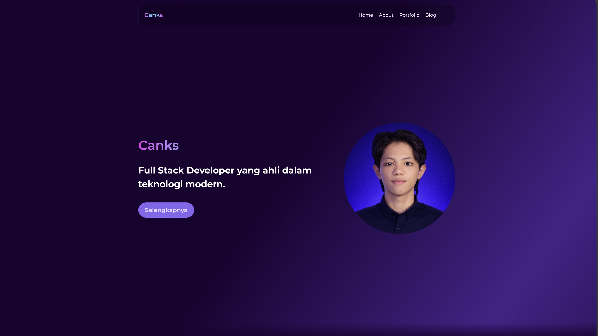

# Portfolio Full Stack - Astro Template

Selamat datang di repository **Portfolio Full Stack** saya. Project ini dibangun menggunakan **Astro** dan dirancang untuk menampilkan berbagai proyek yang pernah saya kerjakan, mulai dari aplikasi web, sistem ERP, hingga aplikasi enterprise. Portfolio ini memiliki tampilan yang modern, responsif, dan fokus pada performa serta kemudahan navigasi.

Di repository ini, kamu bisa menemukan informasi mengenai struktur project, cara menambahkan data portfolio, teknologi yang digunakan, serta contoh implementasi yang digunakan dalam pengembangan aplikasi ini.



## Daftar Isi

1. [Cara Penggunaan](#cara-penggunaan)
2. [Halaman](#halaman)
3. [Menambah proyek (Markdown)](#menambah-proyek-markdown)
4. [Tema](#tema)
5. [Sistem Animasi](#sistem-animasi)
6. [Teknologi yang Digunakan](#teknologi-yang-digunakan)
7. [Desain Figma](#desain-figma)
8. [Bug dan Permasalahan](#bug-dan-permasalahan)
9. [Halaman Utama](#halaman-utama)

## Cara Penggunaan

Project ini memakai [Bun](https://bun.sh) sebagai package manager dan runtime (lockfile: `bun.lock`).

```bash
bun install
bun --bun run dev      # http://localhost:4321
bun --bun run build    # hasil build ada di /dist
bun --bun run preview  # mencoba hasil build
```

> `--bun` membuat skrip Astro berjalan di runtime Bun (tanpa Node.js), sama seperti saat build di Docker. Tanpa flag ini Bun tetap memakai Node.js bila terpasang (Astro 7 membutuhkan Node.js >= 22.23.4).

Untuk menambahkan proyek baru, buat file Markdown di `src/content/projects/` (lihat [Menambah proyek](#menambah-proyek-markdown)). Daftar keterampilan ada di `src/components/data/skillsData.js`, artikel blog di `src/content/blog/`.

## Halaman

| URL | Isi | Sumber data |
| --- | --- | --- |
| `/` | Beranda: hero, tentang, keterampilan, galeri portofolio (+ blog bila aktif) | semua sumber di bawah |
| `/proyek/` | Semua proyek + penyaring berdasarkan teknologi | `src/content/projects/*.md` |
| `/proyek/<slug>/` | Detail satu proyek (deskripsi lengkap dari isi file Markdown) | `src/content/projects/<slug>.md` |
| `/keterampilan/` | Teknologi per kelompok, tertaut ke proyek yang memakainya | `skillsData.js` + proyek |
| `/kontak/` | Saluran kontak + form yang membuka aplikasi email (situs statis, tanpa backend) | `src/pages/kontak/index.astro` |
| `/blog/`, `/blog/<id>/` | Daftar & artikel — **sedang disembunyikan** (lihat di bawah) | `src/content/blog/*.md` |

Menu ada di `src/components/data/menuData.js` (`mainMenu` untuk beranda, `menuPage` untuk halaman lain; menu aktif ditentukan dari URL).

## Menyembunyikan / menampilkan blog

Blog dikendalikan satu saklar di `src/components/data/site.js`:

```js
export const FEATURES = {
	blog: false, // true = tampilkan blog
};
```

Saat `false`: item menu "Blog" dan bagian Blog di beranda hilang, `/blog/` dialihkan ke beranda, halaman artikel tidak dibuat, dan blog dikeluarkan dari sitemap. File artikel di `src/content/blog/` tetap aman. Ubah ke `true` lalu build ulang untuk menampilkannya kembali.

## Menambah proyek (Markdown)

Setiap proyek adalah satu file di `src/content/projects/`. **Nama file = slug** (alamat `/proyek/<slug>/`). Bagian di antara `---` adalah metadata, sisanya adalah deskripsi lengkap dalam Markdown yang ditampilkan di halaman detail.

```md
---
title: "Mebook ERP"                        # judul singkat: kartu, judul halaman, menu
fullTitle: "Mebook - Frontend Application Enterprise Resource Planning System (ERP)"   # opsional
category: "Enterprise"
image: "/img/portfolio/mebook-erp.png"     # relatif ke /public
order: 1                                   # urutan tampil (kecil = lebih dulu)
# lang: "en"                              # opsional: bahasa isi bila bukan Bahasa Indonesia (default "id")
year: 2023
skills: ["React", "Bootstrap"]             # ditulis bebas: "react", "Node.js", "tailwindcss" disamakan otomatis
summary: "Ringkasan singkat untuk kartu dan meta description."
# opsional — tampil di halaman detail bila diisi:
# role: "Full Stack Developer"
# demoURL: "https://..."
# repoURL: "https://github.com/..."
# highlights: ["Modul akuntansi", "Laporan keuangan"]
---

## Penjelasan Singkat

Tulis deskripsi lengkap di sini dengan Markdown biasa (judul, daftar, **tebal**, tautan, kode).
```

Proyek juga boleh ditulis sebagai objek di `src/components/data/portfolioData.js` (format singkat tanpa isi Markdown). Bila slug-nya sama dengan file Markdown, file Markdown yang dipakai. Penggabungan kedua sumber ada di `src/lib/projects.ts`.

Nama teknologi pada `skills` dicocokkan dengan `skillsData.js` (alias `Go`/`Golang` dan `Tailwind`/`TailwindCSS` dianggap sama) sehingga halaman `/keterampilan/` otomatis menautkan proyeknya.

## Tema

Tema gelap/terang dapat diganti lewat tombol di header. Tanpa pilihan tersimpan, tema mengikuti sistem (`prefers-color-scheme`); pilihan disimpan di `localStorage`. Warna didefinisikan sebagai token di `src/styles/global.css`: `--accent` untuk teks/garis aksen dan `--accent-fill` untuk isian (tombol, hover, footer). Atribut `data-theme` dipasang oleh skrip kecil di `<head>` sebelum render pertama (tanpa kedipan).

## Sistem Animasi

Tampilan dirancang dengan bahasa visual **garis**: garis pemandu vertikal, rule yang tergambar saat digulir, bingkai yang digambar dengan DrawSVG, dan medan garis bergelombang di hero. Semua logika animasi ada di `src/scripts/`, dan komponen Astro hanya menandai elemen lewat atribut `data-*`.

| Library | Dipakai untuk |
| --- | --- |
| **GSAP** (ScrollTrigger, SplitText, DrawSVG) | Intro timeline, judul per-kata/huruf, galeri horizontal ter-pin, parallax, rule & bingkai yang tergambar, marquee, medan garis di canvas |
| **Motion** | Reveal berbasis `inView`, garis progres scroll, spring pada menu/nav/hover/tombol magnetik, kursor, popup "kembali ke atas" (muncul dengan spring + cincin progres), penyaring daftar |
| **Lenis** | Smooth scroll yang disinkronkan ke ticker GSAP (`scripts/smooth.ts`) |

Catatan:

- `prefers-reduced-motion: reduce` dihormati: tanpa Lenis, tanpa pin, tanpa scrub — konten tampil statis.
- Keadaan awal animasi hanya aktif bila kelas `js` terpasang di `<html>` (skrip inline di `Layout.astro`), sehingga konten tetap terbaca bila JavaScript gagal dimuat.
- Atribut yang tersedia: `data-line` (rule tergambar), `data-split` (judul naik per kata saat masuk viewport), `data-scrub` (teks menyala mengikuti scroll), `data-reveal` / `data-reveal-group` (muncul saat masuk viewport), `data-magnetic` (tarik ke kursor).

## Teknologi yang Digunakan

- **Bun**: package manager & runtime.
- **Astro 7**: Static site builder dengan JavaScript minimal.
- **GSAP**, **Motion**, **Lenis**: sistem animasi (lihat di atas).
- **Tailwind CSS 4** (via `@tailwindcss/vite`): saat ini hanya dipakai untuk preflight (reset); styling utama memakai CSS dengan design token di `src/styles/global.css`.
- **React 19**: integrasi Astro masih aktif, namun saat ini belum ada komponen React.
- **Geist**, **Geist Mono**, **Instrument Serif**: tipografi (Google Fonts).

## Desain Figma

Kamu dapat melihat dan mengedit desain template ini melalui Figma. Berikut adalah tautan desain Figma yang digunakan:

[Link Desain Figma](https://www.figma.com/design/15EteAKw8d0QCNCucw5lft/mi-primer-blog?node-id=200-643&t=hbUqn1hqSfLcfI92-0)

## Bug dan Permasalahan

Jika kamu menemukan bug atau mengalami kendala saat menggunakan project ini, silakan laporkan melalui halaman Issues pada repository GitHub project ini.

## Halaman Utama

Untuk informasi lebih lengkap dan dokumentasi tambahan, silakan kunjungi halaman utama repository ini di GitHub.

---

Selamat menggunakan dan mengembangkan portfolio ini!  
Jika ada pertanyaan atau ingin berdiskusi lebih lanjut, jangan ragu untuk menghubungi saya.
