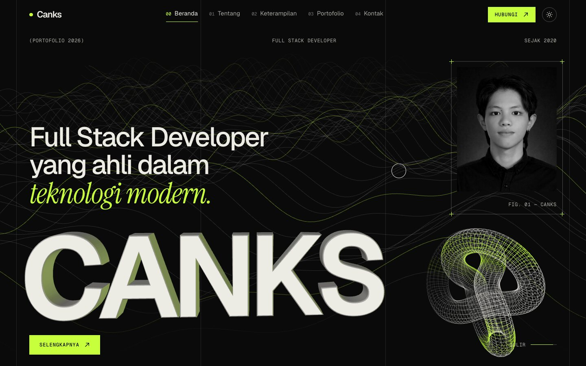

# Canks — Portofolio Full Stack



Situs portofolio pribadi seorang Full Stack Developer, tayang di **[canks.dev](https://canks.dev)**. Dibangun dengan Astro sebagai situs statis, dengan bahasa visual "garis": garis pemandu, rule yang tergambar saat digulir, tipografi besar, dan hero 3D berbasis Three.js.

## Sorotan

- **Hero 3D (Three.js):** lanskap garis berperspektif, teks "CANKS" 3D yang diekstrusi, dan objek garis yang **berubah bentuk mengikuti scroll** di sepanjang beranda.
- **Animasi:** GSAP (ScrollTrigger, SplitText, DrawSVG), Motion, dan Lenis (smooth scroll).
- **Tema gelap/terang** yang mengikuti sistem, tersimpan, dan tanpa kedipan saat dimuat.
- **Proyek dari file Markdown**, halaman detail per proyek, dan penyaring teknologi.
- **SEO:** sitemap, canonical, Open Graph/Twitter Card, dan structured data (JSON-LD).
- **Tetap berfungsi tanpa JavaScript, tanpa WebGL, dan dengan `prefers-reduced-motion`** (lihat [Aksesibilitas](#aksesibilitas-dan-fallback)).

## Teknologi

| | |
| --- | --- |
| Kerangka | [Astro 7](https://astro.build) (situs statis), TypeScript |
| Package manager & runtime | [Bun](https://bun.sh) |
| Animasi | GSAP, Motion, Lenis |
| Grafis 3D | Three.js (WebGL) |
| Gaya | CSS dengan design token (`src/styles/global.css`); Tailwind CSS 4 hanya untuk reset (preflight) |
| Integrasi lain | `@astrojs/sitemap`, `@astrojs/react` (terpasang, belum ada komponen React) |
| Tipografi | Geist, Geist Mono, Instrument Serif |

## Memulai

```bash
bun install
bun --bun run dev      # http://localhost:4321
bun --bun run build    # hasil di /dist
bun --bun run preview  # mencoba hasil build
```

> `--bun` menjalankan skrip Astro di runtime Bun (tanpa Node.js), sama seperti di Docker. Tanpa flag ini Bun memakai Node.js bila terpasang — Astro 7 membutuhkan Node.js ≥ 22.23.4. `dev` dan `preview` berjalan sebagai daemon; hentikan dengan `bun --bun run astro dev stop` / `astro preview stop`.

## Struktur proyek

```text
public/                   aset statis (gambar, ikon teknologi, og.png, robots.txt)
scripts/                  skrip bantu (bukan bagian situs)
src/
├── assets/               outline huruf untuk teks 3D (canks-wordmark.typeface.json)
├── components/
│   ├── sections/         Hero, About, Skills, Work, Journal
│   └── data/             site.js (identitas & saklar fitur), menuData, skillsData, portfolioData, helpers
├── content/
│   ├── projects/         satu file .md per proyek
│   └── blog/             artikel blog (.md)
├── layouts/              Layout (head SEO, tema), BlogLayout
├── lib/                  projects.ts (gabung sumber proyek), seo.ts (JSON-LD)
├── pages/                index, proyek/, keterampilan/, kontak/, blog/, 404
├── scripts/              seluruh animasi & scene 3D (main.ts memuat semuanya)
└── styles/global.css     token warna/tipografi, tema, utilitas
```

## Halaman

| URL | Isi |
| --- | --- |
| `/` | Beranda: hero, tentang, keterampilan, galeri portofolio |
| `/proyek/` | Semua proyek + penyaring teknologi |
| `/proyek/<slug>/` | Detail satu proyek (isi dari file Markdown-nya) |
| `/keterampilan/` | Teknologi per kelompok, tertaut ke proyek yang memakainya |
| `/kontak/` | Saluran kontak + form yang membuka aplikasi email (situs statis, tanpa backend) |
| `/blog/`, `/blog/<id>/` | Blog — **sedang disembunyikan** ([lihat saklar fitur](#saklar-fitur)) |

## Mengelola konten

### Proyek (Markdown)

Setiap proyek adalah satu file di `src/content/projects/`. **Nama file = slug** (alamat `/proyek/<slug>/`). Bagian di antara `---` adalah metadata; sisanya deskripsi lengkap dalam Markdown yang tampil di halaman detail.

```md
---
title: "Mebook ERP"                        # judul singkat: kartu, judul halaman
fullTitle: "Mebook - Aplikasi Frontend Sistem ERP"   # opsional, tampil sebagai "Nama lengkap"
category: "Enterprise"
image: "/img/portfolio/mebook-erp.jpg"     # relatif ke /public
order: 1                                   # urutan tampil (kecil = lebih dulu)
year: 2023
skills: ["React", "Bootstrap"]             # penulisan bebas: "react", "Node.js", "tailwindcss" disamakan otomatis
summary: "Ringkasan singkat untuk kartu dan meta description."
# opsional — tampil di halaman detail bila diisi:
# role: "Full Stack Developer"
# demoURL: "https://..."
# repoURL: "https://github.com/..."
# highlights: ["Modul akuntansi", "Laporan keuangan"]
# lang: "en"                               # bahasa isi bila bukan Indonesia (default "id")
---

## Penjelasan Singkat

Tulis deskripsi lengkap dengan Markdown biasa (judul, daftar, **tebal**, tautan, kode).
```

Proyek juga boleh ditulis sebagai objek singkat di `src/components/data/portfolioData.js`; bila slug-nya sama dengan file Markdown, file Markdown yang dipakai (penggabungan ada di `src/lib/projects.ts`). Setiap proyek otomatis menjadi kartu di beranda, kartu di `/proyek/`, dan satu halaman detail.

### Keterampilan

Daftar dan kelompoknya ada di `src/components/data/skillsData.js`. Teknologi pada `skills` sebuah proyek dicocokkan dengan daftar ini (alias `Go`/`Golang`, `Tailwind`/`TailwindCSS`, dan sejenisnya dianggap sama), sehingga `/keterampilan/` otomatis menautkan proyek yang memakainya.

### Identitas situs dan kontak

`src/components/data/site.js` memuat alamat produksi, email, tautan sosial, dan gambar pratinjau default. Nilai ini dipakai oleh header, footer, halaman Kontak, dan structured data — cukup diubah di satu tempat.

### Blog

Artikel berupa file Markdown di `src/content/blog/` (`title`, `description`, `pubDate`; `noindex: true` untuk artikel yang tidak boleh diindeks).

## Saklar fitur

Di `src/components/data/site.js`:

```js
export const FEATURES = {
  blog: false,           // true = tampilkan blog
  portraitRelief: false, // eksperimen: foto hero sebagai relief 3D (kecerahan dipakai sebagai kedalaman, wajah jadi terdistorsi)
};
```

Saat `blog: false`: menu "Blog" dan bagian Blog di beranda hilang, `/blog/` dialihkan ke beranda, halaman artikel tidak dibuat, dan blog keluar dari sitemap. File artikel tetap aman. Ubah ke `true` lalu build ulang untuk menampilkannya kembali.

## Tema

Tema gelap/terang diganti lewat tombol di header. Tanpa pilihan tersimpan, tema mengikuti sistem (`prefers-color-scheme`); pilihan disimpan di `localStorage`. Warna didefinisikan sebagai token di `src/styles/global.css`: `--accent` untuk teks/garis aksen dan `--accent-fill` untuk isian (tombol, hover, footer). Atribut `data-theme` dipasang oleh skrip kecil di `<head>` sebelum render pertama.

## Sistem animasi

Komponen Astro hanya menandai elemen lewat atribut `data-*`; seluruh logika ada di `src/scripts/`.

| Library | Dipakai untuk |
| --- | --- |
| **GSAP** (ScrollTrigger, SplitText, DrawSVG) | Intro timeline, judul per-kata/huruf, galeri horizontal ter-pin, parallax, rule & bingkai yang tergambar, marquee |
| **Motion** | Reveal `inView`, garis progres scroll, spring pada menu/nav/hover/tombol magnetik, kursor, popup "kembali ke atas", penyaring daftar |
| **Three.js** | (1) Latar hero: lanskap garis yang gelombangnya dihitung di vertex shader, dengan riak mengikuti kursor (`heroScene.ts`). (2) Teks "CANKS" 3D: huruf diekstrusi + di-bevel, diselaraskan dengan `<h1>` (`wordmark3d.ts`). (3) Objek yang berubah bentuk mengikuti scroll (`scrollObject.ts`) |
| **Lenis** | Smooth scroll yang disinkronkan ke ticker GSAP (`smooth.ts`) |

**Objek 3D mengikuti scroll** — satu objek garis (kanvas `position: fixed`) yang berubah bentuk antar-section: trefoil (hero) → donat (tentang) → "apel" (keterampilan) → knot 5-sudut (portofolio) → knot 3,4 (footer). Semua bentuk memakai grid titik yang sama sehingga saling berinterpolasi di GPU, dengan puntiran dan riak saat transisi; kecepatan scroll menambah putaran, dan garis berganti gelap di atas footer lime. Section ditandai `data-scene-stop="hero|about|skills|work|footer"`; posisi dan ukuran tiap stasiun ada di tabel `STATIONS`, bentuknya di fungsi `SHAPES`. Di layar potret objek berada di belakang konten, redup, dan menyembul dari tepi kanan agar teks tidak tertimpa. Hanya aktif di beranda.

**Teks "CANKS" 3D** — bidang depan huruf tanpa pencahayaan sehingga warnanya persis warna teks situs; sisi ekstrusi netral berpencahayaan dengan sapuan lime tipis di tepi. Outline huruf C-A-N-K-S (Geist SemiBold) disimpan sebagai aset 2 KB dan dibuat dengan `scripts/build-wordmark-font.mjs` (butuh paket `opentype.js` sementara; petunjuk ada di kepala skrip).

Semua modul Three.js dimuat sebagai chunk terpisah lewat *dynamic import* (±570 KB mentah) dan hanya di halaman yang memerlukannya.

### Aksesibilitas dan fallback

- Keadaan awal animasi (mis. `opacity: 0`) hanya dipasang bila kelas `js` ada di `<html>` (skrip inline di `Layout.astro`). Kelas itu **tidak** dipasang bila `prefers-reduced-motion: reduce`, dan dicabut otomatis bila skrip utama gagal dimuat dalam 4 detik — konten selalu terbaca.
- Gerak dikurangi: tanpa Lenis, pin, scrub, dan objek yang mengikuti scroll; scene hero dirender sebagai satu bingkai diam.
- Tanpa WebGL: hero tetap tampil lengkap, termasuk `<h1>` HTML aslinya (yang saat WebGL aktif dibuat transparan di bawah teks 3D). Pendeteksian dilakukan diam-diam tanpa galat di konsol.
- Pembaca layar membaca `<h1>`, ``, dan teks HTML biasa; seluruh kanvas 3D bersifat dekoratif (`aria-hidden`).

## SEO

- `site` di `astro.config.mjs` (dan `SITE.url` di `site.js`) menentukan canonical dan sitemap; `@astrojs/sitemap` menghasilkan `sitemap-index.xml`.
- `public/robots.txt` mengizinkan semua crawler dan menunjuk ke sitemap.
- Tiap halaman memiliki canonical, Open Graph, dan Twitter Card dengan `public/og.png` (1200×630); halaman proyek memakai gambar proyeknya.
- Structured data (`src/lib/seo.ts`): WebSite + Person (beranda), CreativeWork (proyek), BlogPosting (artikel).
- `noindex`: halaman 404 dan artikel yang diberi `noindex: true`.

## Build dan deploy

Hasil build adalah situs statis di `dist/`, sehingga bisa disajikan oleh web server statis apa pun.

- **Docker:** `Dockerfile` membangun dengan `oven/bun` lalu menyajikan hasilnya lewat nginx; jalankan dengan `docker compose up --build` (`.dockerignore` mencegah `node_modules` lokal ikut tersalin).
- **Server sendiri:** salin isi `dist/` ke web root. Aset di `_astro/` berhash, jadi pada deploy berikutnya file lama aman dibersihkan setelah cache HTML kedaluwarsa.

## Lisensi dan atribusi

Kode dirilis di bawah lisensi MIT (lihat [LICENSE](LICENSE)). Font **Geist** dan **Geist Mono** berlisensi [SIL Open Font License 1.1](https://github.com/vercel/geist-font); **Instrument Serif** berlisensi SIL OFL 1.1.
